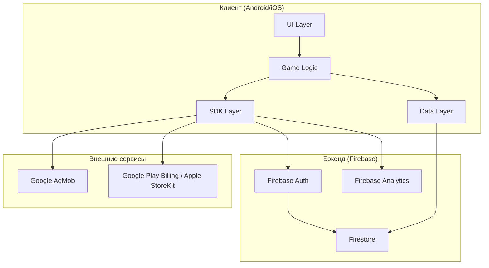
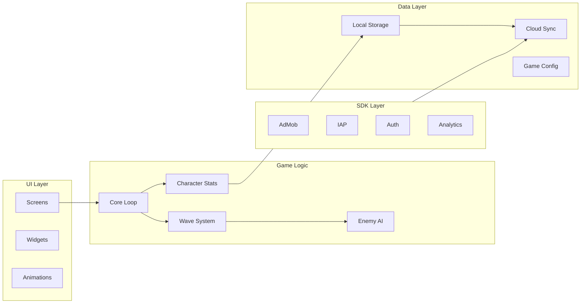
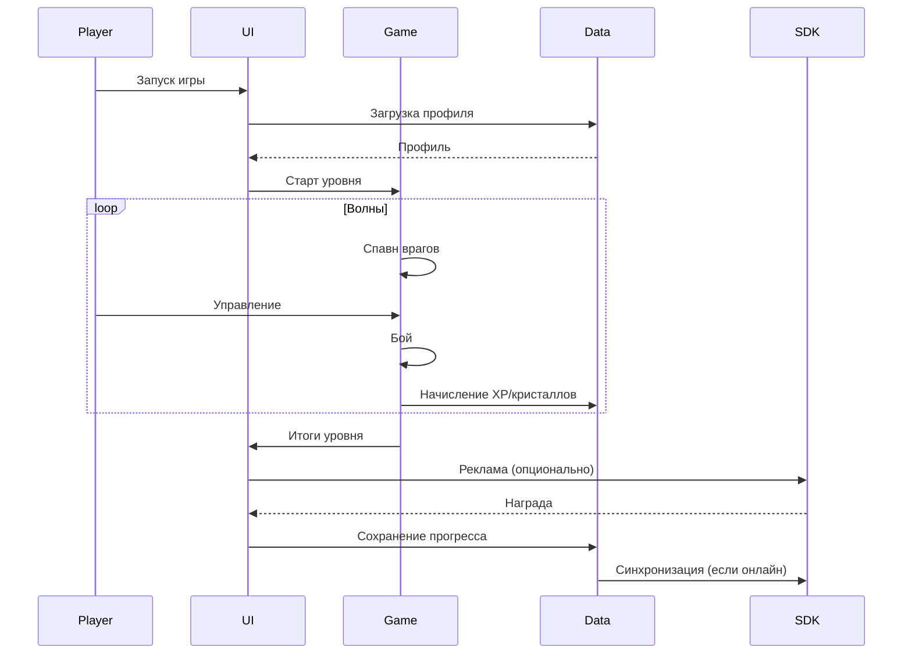
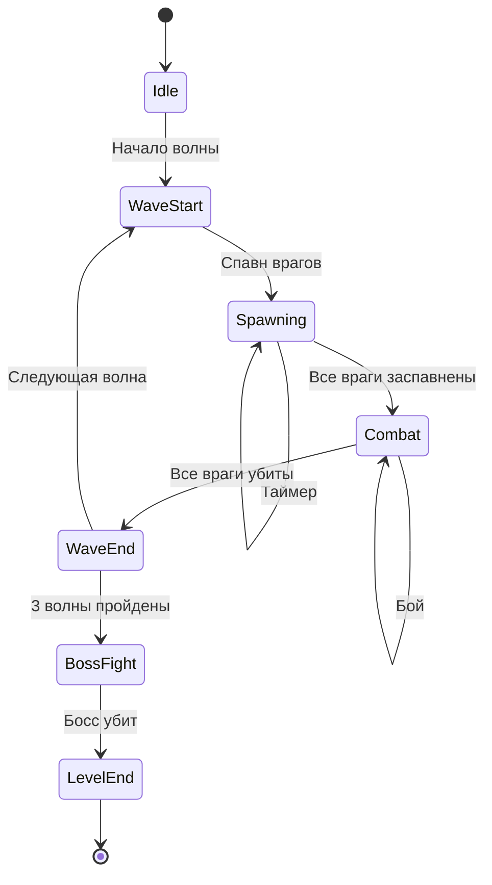
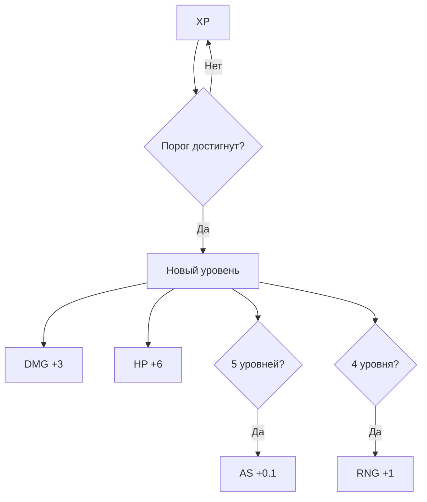
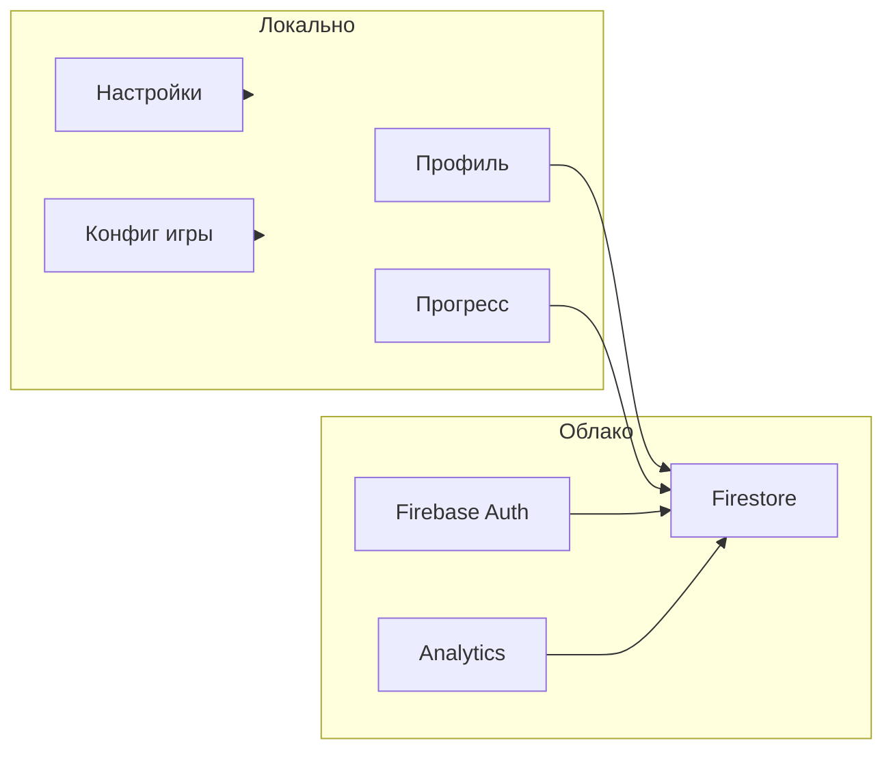

# Architecture — Monster and Magic

**Версия:** 1.0
**Дата:** 2026-10-14
**Автор:** Алена (PO + Геймдизайнер)

---

## 1. Общая схема



---

## 2. Слои клиента



**Описание слоёв:**

| Слой | Что делает | Примеры |
|------|-----------|---------|
| UI Layer | Экраны, виджеты, анимации | Main Menu, Character Screen, Battle Screen |
| Game Logic | Core Loop, волны, враги, характеристики | Game Manager, Wave Manager, Enemy AI |
| Data Layer | Локальное хранилище, облако, конфиг | Local Storage, Cloud Sync, Game Config |
| SDK Layer | Реклама, IAP, авторизация, аналитика | AdMob, IAP, Auth, Analytics |

---

## 3. Core Loop



**Что делает игрок:**
1. Запускает игру.
2. Выбирает уровень.
3. Управляет героем на арене.
4. Проходит волны.
5. Побеждает босса.
6. Получает награды.

---

## 4. Система волн



**Параметры волны:**

| Параметр | Значение |
|----------|----------|
| Частота спавна | 2.0 → 0.5 сек |
| Частота (11–21) | 1.4 → 0.5 сек |
| Длительность | 8–24 сек |
| Врагов за волну | 5–32 |
| Босс | 4-я волна каждого уровня |

**Типы врагов:**

| Тип | Появление | HP | Урон | Скорость | XP | Кристаллы |
|-----|-----------|-----|------|----------|-----|-----------|
| Обычный | Ур. 1 | 20 | 5 | 1.0 | 2 | 1 |
| Быстрый | Ур. 7 | 10 | 3 | 2.0 | 4 | 2 |
| Танк | Ур. 14 | 80 | 10 | 0.5 | 8 | 5 |
| Копейщик | Ур. 21 | 120 | 15 | 1.0 | 20 | 15 |
| Босс | Каждый ур. | 100–3000 | 10–26 | 0.5 | 100–500 | 20–100 |

---

## 5. Прогрессия персонажа



**Формулы:**

| Параметр | Формула |
|----------|---------|
| Порог XP | `100 * (1.2 ^ (level - 1))` |
| DMG | `10 + (level - 1) * 3` |
| HP | `100 + (level - 1) * 6` |
| AS | `1.0 + floor((level - 1) / 5) * 0.1` |
| RNG | `2 + floor((level - 1) / 4) * 1` |

**XP с монстров:**

| Тип | XP |
|-----|-----|
| Обычный | 2 |
| Быстрый | 4 |
| Танк | 8 |
| Копейщик | 20 |
| Босс | `20 + (level - 1) * 4` |

**Прогресс по игровым уровням:**

| Игровой уровень | Уровень персонажа |
|-----------------|-------------------|
| 1 | 1 |
| 5 | 5 |
| 10 | 9 |
| 15 | 12 |
| 21 | 15 |

---

## 6. Хранение данных



**Локально:**

| Что | Где |
|-----|-----|
| Профиль | Локальное хранилище |
| Прогресс | Локальное хранилище |
| Настройки | Локальное хранилище |
| Конфиг игры | Локальное хранилище |

**В облаке:**

| Что | Где |
|-----|-----|
| Синхронизация профиля | Firestore |
| Аналитика | Firebase Analytics |
| Лидерборды (позже) | Firestore |

---

## 7. Технологический стек

| Компонент | Технология |
|-----------|------------|
| Движок | Godot 4.x / Unity 2022 LTS |
| Язык | GDScript / C# |
| Локальное хранилище | JSON / SQLite |
| Облако | Firebase (Auth, Firestore) |
| Реклама | Google AdMob |
| IAP | Google Play Billing / Apple StoreKit |
| Аналитика | Firebase Analytics |
| Доска | Kaiten |
| Репозиторий | GitHub |
| Документация | Google Docs / Notion |

---

## 8. Структура проекта (Godot)

```
project/
├── scenes/
│   ├── ui/
│   │   ├── main_menu.tscn
│   │   ├── character_screen.tscn
│   │   ├── battle_screen.tscn
│   │   ├── season_pass.tscn
│   │   └── shop.tscn
│   ├── game/
│   │   ├── level.tscn
│   │   ├── wave.tscn
│   │   └── boss.tscn
│   └── levels/
│       ├── level_01.tscn
│       └── ...
├── scripts/
│   ├── core/
│   │   ├── game_manager.gd
│   │   ├── wave_manager.gd
│   │   └── level_manager.gd
│   ├── enemies/
│   │   ├── enemy_base.gd
│   │   ├── normal.gd
│   │   ├── fast.gd
│   │   ├── tank.gd
│   │   └── spearman.gd
│   ├── economy/
│   │   ├── crystals.gd
│   │   └── xp.gd
│   └── sdk/
│       ├── admob.gd
│       ├── iap.gd
│       └── auth.gd
├── assets/
│   ├── sprites/
│   ├── sounds/
│   └── fonts/
├── data/
│   ├── waves.json
│   ├── enemies.json
│   └── balance.json
└── project.godot
```

---

## 9. Что НЕ входит в MVP

- Мультиплеер
- Чат
- Друзья
- События
- Лидерборды
- Сложная анимация
- Облачные сохранения (только локальные)

---

## 10. Что делать дальше

1. Согласовать архитектуру с Lead Developer.
2. Выбрать движок — Godot или Unity.
3. Создать пустой проект.
4. Настроить экспорт на Android.
5. Реализовать core loop.

---

## 11. Связанные документы

| Документ | Где |
|----------|-----|
| GDD | `docs/gdd.md` |
| Балансные таблицы | Google Sheets |
| Open Questions | `docs/open_questions.md` |
| Product Backlog | Kaiten |
| Lean Canvas | `docs/lean_canvas.md` |
| Метрики | `docs/metrics.md` |
| Макеты | Figma / Miro |

---

## 12. История изменений

| Версия | Дата | Что изменилось |
|--------|------|----------------|
| 1.0 | 2026-10-14 | Первая версия |